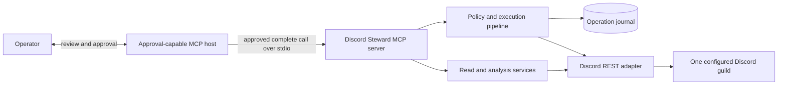

# Architecture

Status: implemented. The running server uses atomic server profiles, exact startup manifests, direct operations, durable journaling, and no internal approval or plan/apply pipeline. All 173 catalog operations are implemented. Policy schema 3 selects `InteractiveApproval`; schema 4 can explicitly select dangerous `UnrestrictedAutonomy`.

For multi-server deployments, each process loads one immutable profile that atomically binds guild ID, policy, risk gates, protected resources, credential alias, and guild-scoped durable paths. Named MCP entries select profiles; tools never select or accept a guild. See [server profiles](server-profiles.md).

## Product boundary

Discord Steward manages one Discord guild through deterministic operations. It does not generate natural language or monitor conversations. In `InteractiveApproval`, an approval-capable MCP host interprets the owner's request, presents each complete tool call for operator approval, and invokes Steward only after approval. `UnrestrictedAutonomy` explicitly trusts an autonomous caller and removes that approval assumption plus local target and permission protections.

MCP is an interface, not the domain layer. Policy, precondition, execution, verification, and audit types must not depend on MCP protocol types. Operator approval belongs to the host boundary above every tool, not to Steward's domain model.

## Runtime boundaries

### MCP host

- In `InteractiveApproval`, owns operator approval before every invocation, including reads.
- In `InteractiveApproval`, shows the exact tool name, complete arguments, annotations, and expected effect.
- Does not treat tool annotations alone as authorization.

### Discord Steward server

- Runs locally as a child process over `stdio`.
- Writes only JSON-RPC to stdout. All logs go to stderr.
- Has no HTTP listener.
- Has no LLM client or model credentials.
- Registers exact typed tool names in an immutable startup manifest; the all-tools selector advertises the complete catalog and exact-name restrictions remain optional.
- In `InteractiveApproval`, trusts the configured host to have approved a call; standard MCP carries no approval attestation.
- In `UnrestrictedAutonomy`, reports the dangerous mode and trusts the caller without an approval claim.

### Discord adapter

- Uses `DiscordRestClient` from `Discord.Net.Rest`.
- Does not connect to the Gateway in the initial product.
- Does not request Message Content, Presence, or Guild Members intents in Phase 1.
- Resolves only the configured guild from trusted process configuration.
- Returns normalized domain snapshots rather than Discord SDK objects.

### Control plane

Target domain services:

- `IDiscordGuildReader`: read normalized guild, role, channel, overwrite, and permitted audit data with explicit R1-redacted and R2-member views.
- `PermissionExplainer`: implemented pure role-only calculation of Discord permission and overwrite rules.
- `GuildLinter`: pure policy checks over a snapshot.
- `PolicyEvaluator`: rejects prohibited targets, permissions, and risk levels.
- `ToolManifest`: expands the optional all-tools selector or validates configured exact names, intersects them with open risk gates, exposes the resolved immutable names and digest, and diagnoses missing planning-read or recovery companions for custom restricted manifests.
- `OperationRegistry`: maps a versioned operation discriminator to its typed validator, Discord writer, verifier, and reconciler.
- `OperationJournal`: persists globally unique request IDs as a database primary key, canonical call digests, idempotency claims, preflight evidence, observed state, and outcomes.
- `OperationExecutor`: validates one already-approved typed call, checks current state, issues one Discord mutation request, and verifies the exact result.
- `IResourceDigestValidator`: computes versioned conflict-domain digests for channels, roles, members, guild settings, messages, and integrations.
- `OutcomeReconciler`: performs read-only endpoint-specific recovery for uncertain operations and never reissues their writes.
- `AsyncJobTracker`: binds documented Discord background work to its originating request and resource; targeted invites allow one in-flight job per invite because Discord exposes no job ID.
- `ConfigurationSnapshotter`: creates content-free state digests used as explicit tool preconditions; R1 snapshots retain permitted counts/digests but omit member-overwrite, creator, and uploader IDs.
- `AuditWriter`: records durable local evidence and a short correlation ID in Discord audit-log reasons.
- `AssetVault` and `IAssetValidator`: import digest-bound files only from a configured local inbox and centrally validate immutable asset ID, digest, media type, and size for every consuming operation.
- `WebhookSecretVault`: stores encrypted webhook credentials separately from operation evidence.

## Identity design

Use a dedicated Discord application named for Steward, such as `DiscSteward`; Discord reserves its brand name in application names. Disable `Public Bot`, set the default installation link to `None`, and use a manually generated owner-only OAuth2 guild-install URL. Do not reuse another bot's token or application.

The first bot role should have only permissions required by the current phase. Read-only Phase 1 should avoid mutation permissions. Before write support, review each required permission separately and keep the Steward role below owner and moderator roles.

A stronger deployment splits credentials by operator role:

- An observer identity remains loaded for routine inspection.
- Operator identities are loaded only for their exact write manifests.

Keep Discord reads and writes behind separate interfaces so the split remains possible.

## Calls and preconditions

In `InteractiveApproval`, the complete MCP call is the reviewed operation. In `UnrestrictedAutonomy`, it is the exact declared autonomous operation. Every effectful call includes:

- A caller-generated globally unique UUID `request_id`.
- The configured guild ID, supplied by the server rather than the tool call.
- Printable operator intent in `reason`.
- One typed operation with exact target IDs and explicit `set`, `clear`, replacement, or desired-presence fields.
- An `expected_state_digest` or resource-specific equivalent from a prior approved read.
- A canonical invocation digest reserved before any Discord write.

Use versioned conflict-domain preconditions instead of hashing the entire guild. A simple update covers the full target resource. Relationship and hierarchy operations also cover relevant parents, sibling ordering, overwrite sets, or role ceilings. Activity outside that declared domain should not invalidate a call. Opaque plan IDs are not valid target-tool inputs because they hide the approved effect.

Convenience operations cannot resolve hidden conventions after approval. An archive or restore call includes its exact destination category, name, visibility, overwrite set, and relevant digests. Permission sync includes the complete desired overwrite set and proves that it matches the parent digest. Create operations bind the exact parent or guild container state. Dynamic target selection, such as pruning whichever members happen to be inactive at execution time, is not a supported write.

## Authorization modes

In `InteractiveApproval`, the MCP host obtains operator approval before invoking any tool. Once invoked, Steward never requests another approval and never accepts a model-supplied approval field.

This boundary is only as strong as the configured host. Standard MCP does not prove that a confirmation prompt was displayed. A future host-signed, one-time call attestation could bind operator identity, canonical call digest, and expiry in transport metadata, but it is not required for the initial local deployment and must not become an `approved: true` argument.

Before enabling interactive writes, the operator must verify that the selected host displays the exact tool name and complete JSON arguments and requires a deliberate approval action for every invocation. An unattended or auto-approving host is not an `InteractiveApproval` deployment.

A future host-signed, one-time call attestation may bind operator identity, canonical call digest, manifest digest, and expiry in transport metadata. It must not be implemented as a `verify_approval` tool or an `approved: true` argument because either would let the caller assert its own authorization.

In `InteractiveApproval`, local policy remains defense in depth. It controls the exact startup manifest, independent risk gates, protected targets, and prohibited permissions; it is not an approval workflow. `UnrestrictedAutonomy` forces the complete manifest and all gates open, drops protected and denied policy, permits Administrator, and relaxes deletion blockers. Configuration is parsed and snapshotted once at startup. On-disk changes are ignored until restart, and no tool can change authorization mode or loaded settings during a process lifetime.

## Execution and recovery

Discord does not provide conditional writes or multi-operation transactions. Keep each invocation to one Discord mutation request:

1. Canonicalize the typed call and validate its manifest entry, static policy, targets, and asset references.
2. Atomically reserve the globally unique `request_id` with operation discriminator, schema version, call digest, targets, and redacted audit representation.
3. Re-read the complete conflict domain through the configured guild. Validate ownership, preconditions, current Discord permissions, role hierarchy, protected resources, and asset digests.
4. Atomically claim execution and persist preflight evidence.
5. Immediately issue the one approved Discord mutation request, at most once.
6. Persist returned resource IDs before other fallible local work.
7. Re-read exact affected state and persist a verified result, explicit partial result, documented processing state, or uncertain outcome.

There is an unavoidable race between final preflight and Discord accepting the write. Keep that interval free of unrelated work and detect observable drift during verification, but do not claim atomic compare-and-swap semantics that Discord does not provide.

Never claim success until post-write Discord state matches the explicit desired state. Reusing a `request_id` with the same call returns its prior result; using it with a different call fails. A new write attempt requires a new approval and request ID. `reconcile_operation` may perform exact-ID, nonce, desired-state, or audit-correlation reads for an uncertain result, but it never retries the mutation or chooses a created resource by name.

Operations that need two Discord mutation requests are two independently approved tool calls. Endpoint-internal multi-resource effects are allowed only when the exact target set and side effects are visible in the call. No automatic compensation is hidden inside an operation.

Destructive operation definitions include a typed cascade analyzer. It enumerates related resources and configuration references before approval and revalidates the approved `expected_cascade` at preflight. Unbounded contents of the exact deleted resource may be approved categorically, but unrelated server-selected targets are not. Ban operations set Discord history deletion to zero.

For official asynchronous endpoints, a verified HTTP acceptance produces a nonterminal `accepted` result and `processing` journal state rather than `outcome_unknown`. A separately approved status read may transition the journal to succeeded or failed. The tracker rejects overlapping targeted-invite jobs for the same invite code so Discord's job-status endpoint remains attributable.

Verifiers compare normalized exact values after every write. Permission writers compare the complete allow and deny sets or overwrite array; an accepted but mismatched representation is a partial failure, not success.

## Persistence

SQLite is the local operation and execution journal. Schema version 3 adds a versioned operation discriminator and declares globally unique `request_id` as the table primary key; tool name and target IDs are indexed evidence, not additional key components. Reusing a request ID with a different canonical digest is an `idempotency_conflict`. The schema stores preconditions, execution claim, timestamps, safe observed state, and terminal or processing outcome. Legacy plan and approval rows remain readable historical evidence but are not executable through the target tool surface.

Each process start records the manifest digest, exact registered names, risk gates, binary version, and policy digest. Administrative writes fail closed when the journal is unavailable; read-only Discord inspection remains independent. Journal retention is configured locally and never controlled through an MCP tool. On Linux, Steward uses the patched system SQLite library instead of a bundled native library with a known advisory.

Do not store Discord message bodies, attachment bytes, or webhook tokens in the journal by default. For content operations, store the canonical call digest, sizes, media types, allowed-mention IDs, target IDs, and verification evidence without the body. Configuration operations may store normalized before, desired, and observed fields needed for audit. Content retention beyond those digests requires a separate explicit policy.

The asset vault and webhook secret vault are separate from SQLite operation evidence. Asset entries are immutable and content-addressed. Webhook tokens are encrypted with key material supplied outside the repository, have restrictive local permissions, and are never returned through MCP. Discord does not expose atomic token rotation, so replacement and old-webhook deletion remain separate approved operations.

## Integration independence

Do not reference or copy assemblies from unrelated Discord bots. Shared code should be extracted only after both projects have a demonstrated stable abstraction, not merely because both use Discord.Net.

Protect resources owned by other bots or integrations by configured IDs where possible. Use installation-specific name prefixes only as a secondary guard rather than the primary identity.